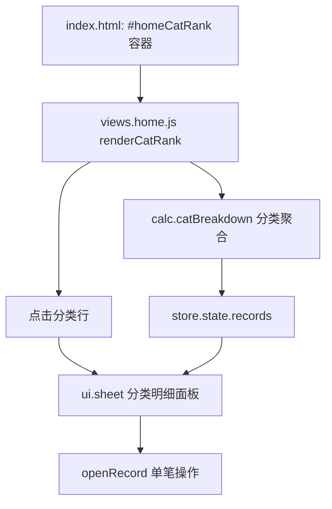

## 产品概述

在首页新增一张「本月花在哪」的支出构成统计卡，把本月每一笔支出按分类汇总，用横向排名条按金额从多到少排列，让用户一眼看出钱主要花在哪些分类上；点击某个分类可查看该分类本月的全部流水。

## 核心功能

- 首页新增统计卡片，位于「本月预算 / 待记入提醒」之后、「近 6 个月收支」之前
- 按支出分类聚合，金额从高到低排序；每行展示排名、分类图标、分类名、金额、占本月支出的百分比与横向进度条
- 进度条长度按「该分类金额 ÷ 最大分类金额」绘制，使第一名占满整行，差距更容易比较
- 卡片标题右侧显示本月支出总额与涉及分类数，例如「5 类 · ¥3,240.00」
- 点击任一分类行，弹出该分类本月流水明细（每笔的备注、日期、金额），弹窗顶部显示该分类合计与占比
- 卡片跟随首页顶部的月份切换联动：切到上月即显示上月构成；某月没有支出时不显示该卡片，不留空白占位

## 视觉与交互

- 与本项目现有的奶油色卡片风格一致：浅纸底、细描边、大圆角、极轻阴影
- 排名前 3 的分类使用暖色进度条（珊瑚红 / 蜜黄 / 薄荷绿）形成视觉焦点，其余分类使用低饱和的米灰，突出「花得最多」的分类
- 进度条入场时从 0 平滑展开；按下整行有轻微透明度反馈；金额使用等宽数字对齐
- 320px 小屏下不折行、不溢出，分类名过长时省略显示

## 技术栈

沿用现有无构建的纯静态结构，不引入任何依赖与框架：

- 结构：`index.html`（内联 SVG 图标库 + 页面容器）
- 逻辑：原生 ES5 风格 IIFE 模块，`window.App` 命名空间（util / store / calc / actions / chart / ui / views.* / app）
- 样式：`css/base.css`（设计令牌）+ `css/components.css`（通用组件）+ `css/pages.css`（页面级）
- 数据：`localStorage`（store.js），金额统一以「分」为整数存储
- 验证：本地 `python3 -m http.server` + `agent-browser` 截图回归

## 实现方案

### 数据层：复用并小幅扩展 `App.calc.catBreakdown`

`js/calc.js` 第 44 行已存在未被调用的 `catBreakdown(ym, type)`，返回 `[{ cat, amount, pct }]` 且已按金额降序排序，正好满足需求，直接复用。仅做一处向后兼容的增量扩展：为每项补充 `count`（该分类笔数），供卡片副文案与明细弹窗标题使用；现有无调用方，不影响任何既有逻辑。

聚合复杂度 O(n)（n 为该月记录数），一次遍历完成，无嵌套循环；页面每次刷新最多 9 行，无性能压力。

### 视图层：`js/views.home.js` 新增 `renderCatRank()`

- `init()` 内缓存 `els.catRank = document.getElementById('homeCatRank')`，并在 `if (bound) return;` 之后用事件委托绑定容器点击（与 `els.recent` 现有写法一致），避免重复绑定
- `render()` 中在 `renderPending()` 之后调用 `renderCatRank()`，与 DOM 中卡片位置对应
- 无支出记录时置空容器内容并提前返回（不渲染空卡片），避免首页出现无意义占位
- 标题文案沿用现有约定：`ym === U.currentYm() ? '本月花在哪' : '当月花在哪'`
- 进度条宽度取 `amount / maxAmount * 100`，百分比文本取 `pct`（占本月支出比例），两者语义区分清楚
- 每行使用 `<button type="button" class="cr-row" data-cat="...">`，带 `aria-label`（分类名 + 金额 + 占比 + 查看明细），键盘可聚焦

### 交互层：点击分类查看明细

- 新增 `openCatDetail(catId)`，用 `App.ui.sheet({ title, html })` 打开底部面板（沿用「编辑这笔」「固定收支」已有的面板样式与 body 锁滚动机制）
- 面板内容：`<p class="act-sub">共 N 笔 · ¥金额 · 占本月支出 X%</p>` + 复用 `.rec / .rec-ico / .rec-main / .rec-amt` 结构的流水行，按日期倒序（`recordsOf` 升序结果 `slice().reverse()`）
- 行点击后 `s.close()` 并 `setTimeout(openRecord(rec), 120)` 进入现有的记录操作面板（详情/编辑/删除），与项目里「actionSheet 关闭后再打开下一个面板」的既有节奏保持一致，避免面板叠加
- 查询某分类记录时复用 `C.recordsOf(ym, 'expense')` 后按 `categoryId` 过滤，单次打开做一次 O(n) 过滤即可，不缓存、不失联

### 样式层：`css/pages.css` 首页区块新增

- 新增 `.cat-rank`（卡片）、`.cr-row`（行）、`.cr-rank / .cr-ico / .cr-name / .cr-amt / .cr-pct`（行内元素）、`.cr-bar > i`（进度条）
- 进度条颜色按行序：第 1 名 `#DE7A6A`、第 2 名 `#F0B36A`、第 3 名 `#8FD0B8`、其余 `#C7BBA6`，与现有 `--red / --butter / --mint` 系同源，保持整体色调统一
- `width` 过渡使用现有缓动风格 `cubic-bezier(.2,.8,.3,1)`（与 `.budget-bar i` 一致），刷新时自然展开
- 使用 flex + `min-width:0` + `text-overflow:ellipsis` 保证 320px 下不溢出；金额使用 `font-variant-numeric:tabular-nums` 对齐

## 实施要点

- **不修改数据结构与存储**：纯派生统计，无需迁移、无需改导入导出
- **避免重复绑定**：新增事件委托必须放在 `bound` 判断之后，与现有代码保持一致
- **空值兜底**：历史数据中若出现已下线的 `categoryId`，`U.cat('expense', id)` 会回退到「其他」，不会抛错
- **浮点展示**：百分比取整展示（`Math.round`），但进度条宽度用原始比例，避免 100% 溢出；占比极小时给最小可见宽度（如 3%）
- **边界**：切换月份 / 删除记录 / 编辑分类后 `App.refreshAll()` 会重新渲染，卡片与明细自动同步；弹窗打开期间数据被外部改动（如定时任务补记）不影响已渲染内容，关闭后刷新即恢复一致
- **热路径**：`catBreakdown` 与明细过滤均只遍历当月记录，不触碰全量历史；首页 `render` 仍只做一次渲染，未新增额外 DOM 遍历

## 架构与目录



## 目录结构

```text
AccountingV2/
├── index.html                 # [MODIFY] 首页 section 内新增 <div id="homeCatRank"></div>，位置在 #homePending 之后、#homeTrendCard 之前
├── js/
│   ├── calc.js                # [MODIFY] catBreakdown 每项增加 count 字段（该分类笔数），保持按金额降序；无其他改动
│   └── views.home.js          # [MODIFY] init 缓存 els.catRank 并绑定分类行点击委托；render() 增加 renderCatRank()；新增 renderCatRank() 渲染排名卡；新增 openCatDetail(catId) 打开分类流水面板
└── css/
    └── pages.css              # [MODIFY] 首页区块新增 .cat-rank 卡片与 .cr-* 排名条样式（前三名配色、进度条动画、小屏适配、按压反馈）
```

## 关键结构

```js
// calc.js：现有返回结构上新增 count，调用方仅 views.home.js
{ cat: {id, name, icon}, amount: Number /* 分 */, pct: Number /* 0-100 */, count: Number }

// views.home.js：对外仅保持既有 API，不新增全局导出
renderCatRank();            // 渲染首页支出构成卡
openCatDetail(catId);       // 打开某分类本月流水面板
```

## 设计风格

延续项目现有的「奶油纸感 + 柔和薄荷绿点缀」风格：浅纸底卡片、细描边、大圆角、极轻投影，不引入新的视觉语言。

## 卡片布局

标题行：左侧「本月花在哪」，右侧副信息「5 类 · ¥3,240.00」，与「本月预算」卡片的 `card-head` 结构一致。

排名列表：每行两段式。第一段为「序号 + 分类图标 + 分类名 + 金额 + 占比」，第二段为横跨整行的细进度条（高 6px）。行与行之间用虚线分隔，首行无分隔线。整行是一个可点击按钮，按下时透明度轻微降低并伴随 0.98 缩放。

## 视觉层级

- 第 1~3 名是视觉重点：进度条分别为珊瑚红、蜜黄、薄荷绿，金额加粗、颜色更深；序号用加粗小字号呈现
- 第 4 名之后统一使用米灰色进度条与常规文字，与前三名形成自然的注意力衰减
- 进度条按「当行金额 ÷ 最大金额」绘制，第一行必然铺满，后续行的长度差异直接反映金额差距；右侧百分比始终是「占本月支出比例」，两个数字互补而不冲突
- 图标沿用现有分类图标，放在 26px 的奶油色小方框中，与明细列表的图标语言一致

## 交互与动效

- 卡片入场时进度条宽度由 0 过渡到目标值（0.5s，缓动 `cubic-bezier(.2,.8,.3,1)`），切换月份时自然重绘
- 点击分类行：底部面板自下而上滑入，顶部显示「餐饮 · 共 8 笔」，下面一行灰色摘要「¥1,280.00 · 占本月支出 39%」，再列出该分类每笔流水（备注、日期、金额），点某笔可进入单笔操作
- 空状态：某月没有任何支出时整张卡片不出现，首页保持干净

## 响应式

- 移动端优先，内容宽度自适应；320px 宽度下金额与占比同行不换行，分类名超长省略
- 金额数字使用等宽数字特性，右侧对齐，纵向阅读时容易比对
- 卡片内边距、圆角、阴影与首页其他卡片保持完全一致

## Agent Extensions

### Skill

- **agent-browser**
- Purpose: 启动本地静态服务后打开首页，载入示例数据并截图，验证支出构成卡的排名条渲染、点击分类弹出明细面板、切换月份联动以及 320px 宽度下不溢出
- Expected outcome: 产出首页与分类明细面板的截图，确认卡片位置、排名顺序与占比数字正确、弹窗可正常打开关闭，无布局错位